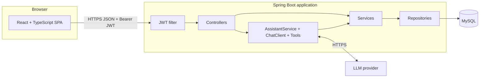
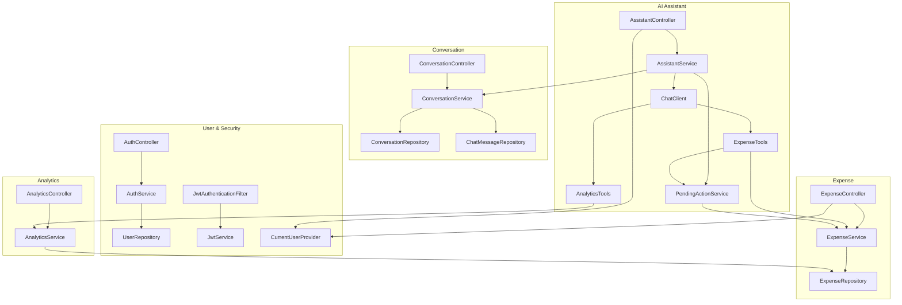
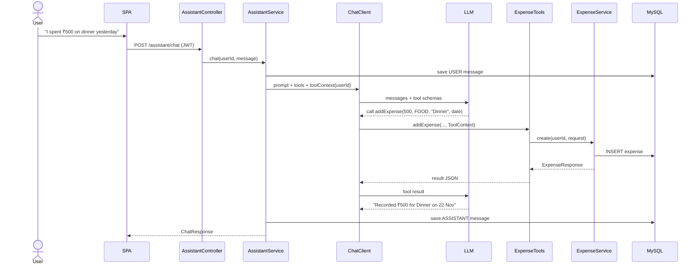
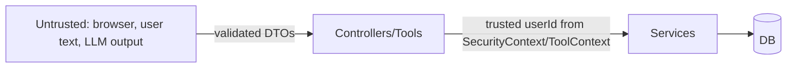

# ARCHITECTURE – AI Expense Assistant

## 1. Style and justification
**Modular monolith**: one Spring Boot application, packages split by responsibility, dependencies only in allowed directions. Why not microservices: one team, tiny domain, no independent scaling or deployment needs. Why not a flat layered app: modules keep the AI code from leaking into expense logic.

**Dependency rules**
```
controller -> service -> repository -> database
assistant.tools -> expense.service / analytics.service   (never repositories)
analytics, expense, conversation never depend on assistant
```

## 2. High-level architecture


## 3. Component architecture


## 4. Frontend–backend interaction
SPA talks only to `/api/v1/**` over JSON. Every request except register/login carries `Authorization: Bearer <JWT>`. The SPA holds no business rules except form-level validation (which the backend re-validates). Details: API_DESIGN.md, FRONTEND_DESIGN.md.

## 5. Module responsibilities
| Module | Owns | Does not do |
|---|---|---|
| **User & Security** | Registration, password hashing, login, JWT create/validate, `token_version`, identifying the current user | Expense or chat logic |
| **Expense** | Expense CRUD, validation (BR-03/04/05), ownership (BR-01/02), filtering | Calculations over many rows |
| **Analytics** | Read-only aggregates over the user's expenses (BR-10) | Writing data |
| **AI Assistant** | `ChatClient`, system prompt, tools, structured output, pending actions, orchestrating a chat turn | Business rules, SQL |
| **Conversation** | Conversation + message persistence, ownership, history queries | Talking to the LLM |
| **Common** | `ErrorResponse`, exceptions, `GlobalExceptionHandler`, `PageResponse`, time/clock config | Domain logic |

## 6. Component communication
In-process method calls only. Services never call controllers. `assistant` calls `expense`, `analytics`, `conversation` services. No module calls `assistant`.

## 7. Manual UI request path
React form → `POST /api/v1/expenses` → JWT filter sets `SecurityContext` → `ExpenseController` (validates DTO, resolves `userId` via `CurrentUserProvider`) → `ExpenseService.create(userId, request)` → `ExpenseRepository.save` → MySQL → `ExpenseResponse` (201).

## 8. AI assistant request path
React chat → `POST /api/v1/assistant/chat` → filter → `AssistantController` → `AssistantService.chat(userId, request)`:
1. Resolve/create conversation (ownership checked).
2. Save the USER message.
3. `ChatClient` call with system prompt (includes today's date), conversation id for memory, tools, and `toolContext{userId}`.
4. LLM may request tools → Spring AI invokes tool methods → tools call `ExpenseService`/`AnalyticsService` with the trusted `userId`.
5. Final text returned; save the ASSISTANT message (with tool metadata).
6. Return `ChatResponse`.



## 9. Spring AI integration architecture
| Piece | Role |
|---|---|
| `ChatModel` (auto-configured by the provider starter) | Talks to the LLM |
| `ChatClient` (built once in `AiConfig`) | Fluent API: system prompt, advisors, tools, call |
| System prompt | Rules: use tools for all data and numbers, ask when info is missing, never claim success without a tool result, never ask for user ids |
| Advisors | `MessageChatMemoryAdvisor` (context), `SimpleLoggerAdvisor` (dev) |
| Tools | `@Tool` methods in `ExpenseTools`, `AnalyticsTools` |
| Structured Output | `.entity(ExpenseDraft.class)` for extraction (Stage 6) and for typed tool parameters |

## 10. Tool calling architecture
Tools are thin adapters: parse arguments → call a service → return a small result record.

| Tool | Calls | Type |
|---|---|---|
| `addExpense` | `ExpenseService.create` | write (immediate; user asked to add) |
| `searchExpenses` | `ExpenseService.search` | read |
| `proposeExpenseUpdate` | `ExpenseService.get` + `PendingActionService.create` | proposes only |
| `proposeExpenseDeletion` | `ExpenseService.get` + `PendingActionService.create` | proposes only |
| `getTotalSpending` | `AnalyticsService.total` | read |
| `getCategorySpending` | `AnalyticsService.byCategory` | read |
| `getHighestSpendingCategory` | `AnalyticsService.highestCategory` | read |
| `getMonthlySummary` | `AnalyticsService.monthlySummary` | read |
| `getDateRangeReport` | `AnalyticsService.report` | read |

**Confirmation design (BR-15):** the LLM can never run an edit/delete. `propose*` stores a pending action (`actionId`, `userId`, type, payload, expiry) and returns a summary. The reply carries `pendingAction`; the UI shows **Confirm / Cancel**; the button calls `POST /assistant/actions/{actionId}/confirm`, which executes via `ExpenseService`. A pending action is bound to the user and conversation that created it.

Tool errors (validation, not found) are returned to the LLM as structured error results so it can ask the user for the missing detail instead of failing.

## 11. Chat Memory architecture
| | Persistent chat history | LLM context (Chat Memory) |
|---|---|---|
| Table | `chat_message` | `spring_ai_chat_memory` (Spring AI JDBC repository) |
| Purpose | What the user sees: full history, reopening conversations | What the model is given: last N messages for follow-ups |
| Size | Unlimited | `MessageWindowChatMemory`, last 20 messages |
| Written by | `ConversationService` | Spring AI advisor |
| Key | `conversation.id` | same id as string |

Why two? The UI needs complete, queryable, ownership-checked history with metadata; the LLM needs a trimmed window in Spring AI's format. Coupling them would force one schema to serve both. If memory is lost, history is intact; a reopened conversation continues because memory is keyed by `conversationId` (and can be rebuilt from `chat_message` if ever needed — future option).

Ownership: `AssistantService` verifies the conversation belongs to the user **before** passing its id to the memory advisor.

## 12. Authentication and authorization
JWT (HS256, signed with a secret from env) issued at login; `JwtAuthenticationFilter` validates signature, expiry and `token_version` and sets the `SecurityContext`. Authorization is *ownership-based*, not role-based: every service method takes `userId` and queries by it. See BACKEND_DESIGN §14–15.

Before Stage 10, `CurrentUserProvider` is implemented by a dev-only class (profile `dev`) returning a seeded user; Stage 10 swaps it for the `SecurityContext` implementation. Services and tools do not change.

## 13. Database interaction
Only repositories touch JPA. All repository queries on user data include `user_id`. Aggregations use JPQL `SUM/GROUP BY` queries, not in-memory loops.

## 14. Error handling architecture
`GlobalExceptionHandler` (`@RestControllerAdvice`) maps exceptions to one `ErrorResponse` shape. Domain exceptions: `ResourceNotFoundException`, `ValidationFailedException`, `PendingActionExpiredException`, `AiUnavailableException`. Tool methods catch domain exceptions and return error results; unexpected tool exceptions are logged and returned as a generic tool failure so the LLM cannot invent success (BR-08).

## 15. Security boundaries

- Trusted: `userId` from the verified JWT.
- Untrusted: request bodies, LLM tool arguments, user messages (prompt injection possible) → validated like any input; no tool accepts a user id.
- LLM has no credentials to the DB and no tool that bypasses services.

## 16. Architectural decisions
| Decision | Justification |
|---|---|
| Shared services (UI + AI) | BR-09; one place to fix bugs |
| Tools as adapters | No duplicate logic (BR-07) |
| `userId` as service parameter | Explicit, testable, works with or without HTTP |
| Backend-enforced confirmation | Safe against prompt injection and model mistakes |
| Analytics in SQL | Exact numbers, BR-10 |
| Separate chat history / memory | See §11 |
| Flyway | Reproducible schema |
| In-memory pending actions | Avoids a table/infra for short-lived state (A8) |
