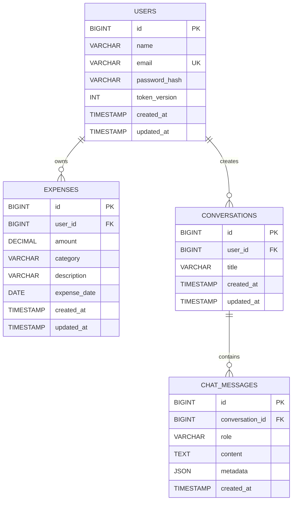

# DATABASE_DESIGN – AI Expense Assistant

## 1. Overview
MySQL 8.4, InnoDB, `utf8mb4` (needed for ₹ and emoji), schema managed by Flyway. Four application tables plus the table Spring AI's JDBC memory repository needs.

| Table | Entity | Purpose |
|---|---|---|
| `users` | `User` | Accounts |
| `expenses` | `Expense` | Expense records |
| `conversations` | `Conversation` | Chat threads |
| `chat_messages` | `ChatMessage` | Messages of a conversation (UI history) |
| `spring_ai_chat_memory` | (Spring AI) | LLM context window (not a JPA entity) |

## 2. ER diagram

## 3. `users`
Stores accounts. Name `users` because `user` is reserved in some SQL dialects.

| Column | Type | Null | Notes |
|---|---|---|---|
| `id` | BIGINT AUTO_INCREMENT | NO | PK |
| `name` | VARCHAR(100) | NO | |
| `email` | VARCHAR(255) | NO | **UNIQUE** (`uk_users_email`), stored lower-case |
| `password_hash` | VARCHAR(60) | NO | BCrypt output (60 chars); never the raw password |
| `token_version` | INT | NO | DEFAULT 0; incremented on logout to invalidate tokens |
| `created_at` | TIMESTAMP(6) | NO | DEFAULT CURRENT_TIMESTAMP(6) |
| `updated_at` | TIMESTAMP(6) | NO | ON UPDATE CURRENT_TIMESTAMP(6) |

## 4. `expenses`
One row per expense. Exactly one owner (BR-01).

| Column | Type | Null | Notes |
|---|---|---|---|
| `id` | BIGINT AUTO_INCREMENT | NO | PK |
| `user_id` | BIGINT | NO | FK → `users.id` (`fk_expenses_user`), `ON DELETE RESTRICT` |
| `amount` | DECIMAL(12,2) | NO | CHECK `amount > 0` (BR-03) |
| `category` | VARCHAR(20) | NO | CHECK in (FOOD, TRANSPORTATION, SHOPPING, ENTERTAINMENT, HEALTH, EDUCATION, BILLS, TRAVEL, OTHER) (BR-04) |
| `description` | VARCHAR(255) | YES | |
| `expense_date` | DATE | NO | The day the money was spent (BR-05) |
| `created_at` | TIMESTAMP(6) | NO | |
| `updated_at` | TIMESTAMP(6) | NO | |

Why VARCHAR + CHECK instead of a categories table or MySQL ENUM: categories are predefined and map to a Java enum; no table needed (no scope creep), and adding one later is a small migration. `ExpenseCategory` enum is the single source in code.

**Indexes**
| Index | Columns | Serves |
|---|---|---|
| `idx_expenses_user_date` | (`user_id`, `expense_date`) | list/filter by date, totals, monthly |
| `idx_expenses_user_cat_date` | (`user_id`, `category`, `expense_date`) | category filters and group-by |

## 5. `conversations`
| Column | Type | Null | Notes |
|---|---|---|---|
| `id` | BIGINT AUTO_INCREMENT | NO | PK; also the chat-memory key |
| `user_id` | BIGINT | NO | FK → `users.id` (`fk_conversations_user`) |
| `title` | VARCHAR(100) | NO | From first message |
| `created_at` | TIMESTAMP(6) | NO | |
| `updated_at` | TIMESTAMP(6) | NO | Touched on each new message; used for ordering |

Index: `idx_conversations_user_updated` (`user_id`, `updated_at` DESC).

## 6. `chat_messages`
| Column | Type | Null | Notes |
|---|---|---|---|
| `id` | BIGINT AUTO_INCREMENT | NO | PK |
| `conversation_id` | BIGINT | NO | FK → `conversations.id` (`fk_messages_conversation`), `ON DELETE CASCADE` |
| `role` | VARCHAR(10) | NO | CHECK in (USER, ASSISTANT) |
| `content` | TEXT | NO | Message text |
| `metadata` | JSON | YES | e.g. `{"toolsUsed":["addExpense"],"pendingActionId":"..."}` for UI tool feedback |
| `created_at` | TIMESTAMP(6) | NO | |

Index: `idx_messages_conversation_created` (`conversation_id`, `created_at`, `id`).
No `user_id` column: ownership is derived through `conversations.user_id`; every message query joins/validates via the owned conversation.

## 7. `spring_ai_chat_memory`
Created by a Flyway migration copied from the Spring AI JDBC repository schema for MySQL (verify column names against the version in use). Holds `conversation_id`, `content`, `type`, `timestamp`. It is a cache-like context store; it can be truncated without losing user-visible history.

## 8. Relationships
- `users 1—N expenses`, `users 1—N conversations`, `conversations 1—N chat_messages`.
- Deleting users is not a feature, so FKs use `RESTRICT`; messages cascade with their conversation.

## 9. Constraints summary
PKs on all `id`; `uk_users_email`; FKs above; CHECKs on `amount`, `category`, `role`; NOT NULL on all required columns.

## 10. User data isolation
| Table | How isolated |
|---|---|
| `expenses` | `user_id` column; every repository method filters by it |
| `conversations` | `user_id` column; filtered by it |
| `chat_messages` | via owned conversation |
| `spring_ai_chat_memory` | keyed by conversation id, which is only used after ownership is verified |

Access pattern: `findByIdAndUserId(id, userId)`; absence → 404 (BR-11).

## 11. Audit timestamps
`created_at`/`updated_at` set by Hibernate auditing (`@CreatedDate`, `@LastModifiedDate`) and defaulted in DDL as a safety net. Stored in UTC (`hibernate.jdbc.time_zone=UTC`).

## 12. Migrations (Flyway)
`V1__create_users.sql`, `V2__create_expenses.sql`, `V3__create_conversations_and_messages.sql`, `V4__create_spring_ai_chat_memory.sql`, `V5__seed_dev_user.sql` (dev profile only, removed/ignored after Stage 10).

## 13. Sample analytics queries (logic only)
- Total: `SELECT COALESCE(SUM(amount),0), COUNT(*) FROM expenses WHERE user_id=? AND expense_date BETWEEN ? AND ?`
- By category: same filter, `GROUP BY category ORDER BY SUM(amount) DESC`
- Highest category: the first row of the by-category query.
