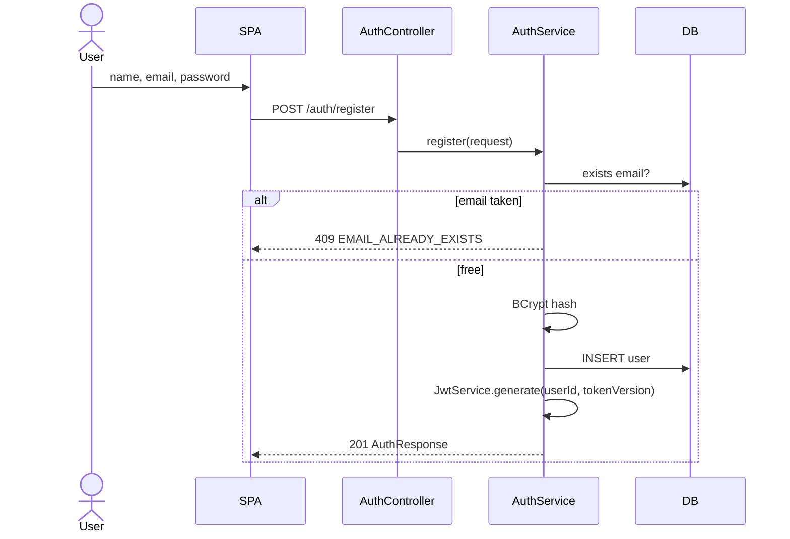
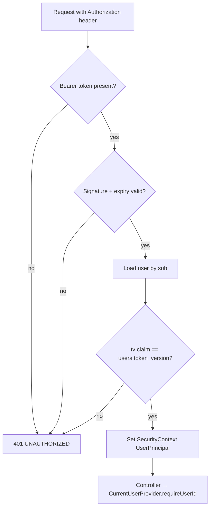
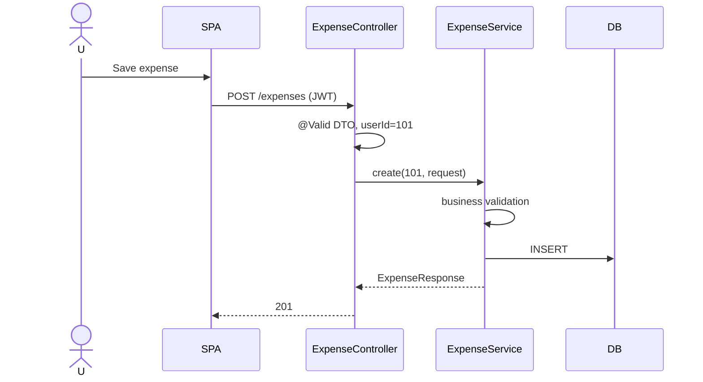
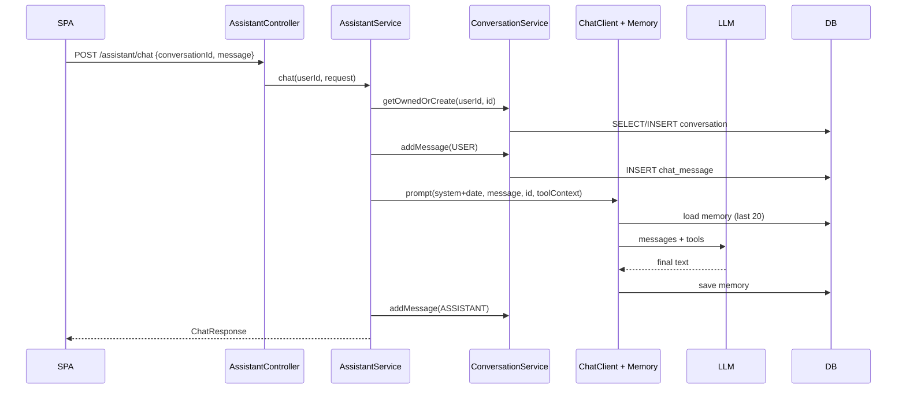
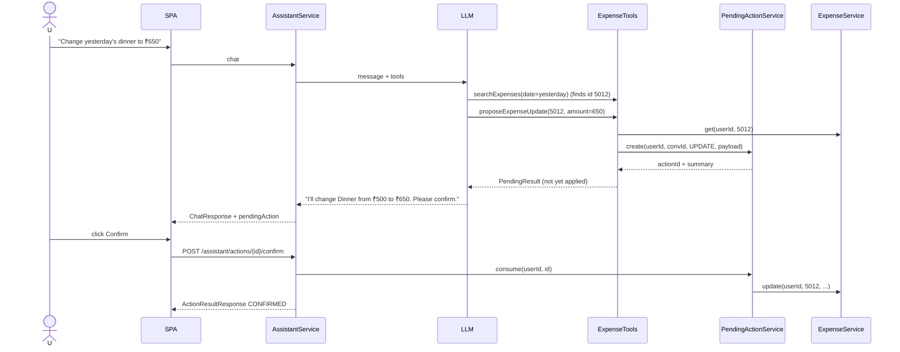
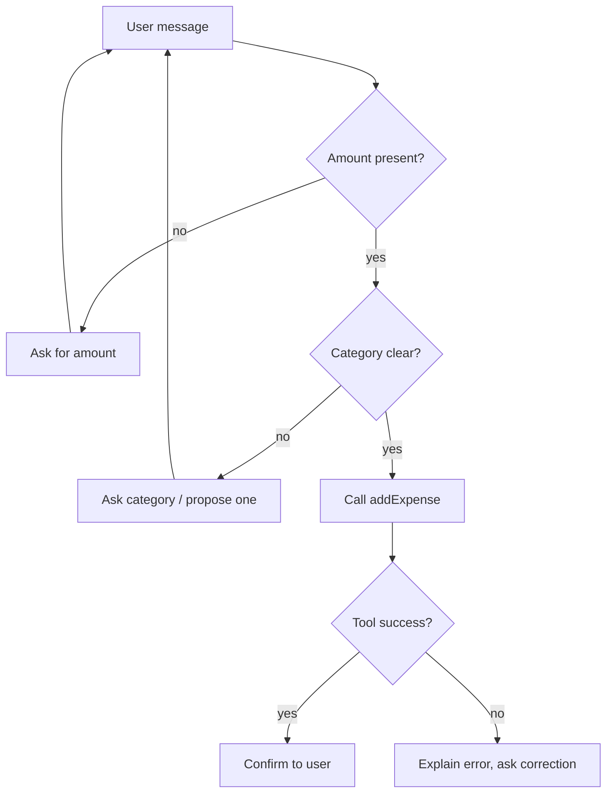

# FLOW_DESIGN – AI Expense Assistant

Notation: **S**tart · **C**omponents · **R**equest/Response · **P**rocessing · **D**B · **OK** success · **FAIL** failure.
Sample user: id 101, Asha. Today = 23 Nov 2026 (Monday).

---
## A. Authentication flows

### A1. Registration
S: Register form. C: SPA, `AuthController`, `AuthService`, `UserRepository`, `JwtService`. R: `POST /auth/register` → `201 AuthResponse`. P: validate → lower-case email → check unique → BCrypt → save → JWT. D: `SELECT` by email, `INSERT users`. OK: token + user returned, SPA stores it. FAIL: 400 validation, 409 `EMAIL_ALREADY_EXISTS`.

### A2. Login
S: Login form. `POST /auth/login`. P: find by email → `BCrypt.matches` → JWT with current `token_version`. D: `SELECT users`. OK: `200 AuthResponse`. FAIL: 401 `INVALID_CREDENTIALS` (identical for unknown email / wrong password).

### A3. Logout
S: Logout button. `POST /auth/logout` (JWT). P: `token_version = token_version + 1`. D: `UPDATE users`. OK: `204`; SPA drops token, redirects to login. FAIL: 401 (already invalid) — SPA still clears local state.

### A4. Protected API request

D: one `SELECT users` per request (acceptable at this scale).

---
## B. Manual expense flows
All: C = SPA, `ExpenseController`, `ExpenseService`, `ExpenseRepository`; `userId` from `CurrentUserProvider`.

| Flow | Request | Processing | DB | OK | FAIL |
|---|---|---|---|---|---|
| Add | `POST /expenses` | DTO validation → service rules (BR-03/04/05/14) → save | `INSERT expenses` | 201 | 400 field errors |
| View | `GET /expenses/{id}`, `GET /expenses` | `findByIdAndUserId` / paged query | `SELECT` | 200 | 404 |
| Edit | `PUT /expenses/{id}` | load owned → validate → update fields | `SELECT`, `UPDATE` (`updated_at` bumps) | 200 | 400, 404 |
| Delete | `DELETE /expenses/{id}` | SPA confirm dialog → load owned → delete | `SELECT`, `DELETE` | 204 | 404 |
| Filter | `GET /expenses?from&to&category&q` | validate `from ≤ to` → specification/JPQL with `user_id` | `SELECT … WHERE user_id=? AND expense_date BETWEEN …` | 200 page | 400 bad range |

## C. Manual analytics flows
S: Dashboard/Analytics page loads or range changes. `GET /analytics/total|by-category|monthly`. C: `AnalyticsController`, `AnalyticsService`, aggregate repository queries. P: validate range (≤ 366 days) → SQL `SUM/COUNT/GROUP BY` with `user_id` → percentages computed from totals (rounded 2 dp) → highest = top row. D: read-only `SELECT`. Monthly: also queries the previous month for comparison. OK: 200; empty data → zeros and empty list. FAIL: 400 invalid range/month.

---
## D. AI assistant flows

### D1. Starting a conversation
S: user types first message on "New chat". `POST /assistant/chat` with no `conversationId`. P: create conversation (title from message) → continue as D2. D: `INSERT conversations`, `INSERT chat_messages`.

### D2. Continuing a conversation
S: message in an open conversation. P: `getOwned(userId, conversationId)` → save USER message → `ChatClient` call with memory keyed by conversation id (last 20 messages loaded) → save ASSISTANT message → touch `conversations.updated_at`. FAIL: 404 if conversation not owned.

### D3. AI expense creation
User: "I spent ₹500 on dinner yesterday." LLM calls `addExpense(500, FOOD, "Dinner", "2026-11-22")` (date resolved from the date in the system prompt) → `ExpenseTools` reads `userId` from `ToolContext` → `ExpenseService.create` (same rules as manual) → `INSERT expenses` → tool returns `ExpenseResult(id, amount, category, description, date)` → LLM replies "Recorded ₹500 for Dinner (Food) on 22 Nov." OK: expense exists; `toolsUsed=["addExpense"]`.
FAIL: service validation error (e.g. amount ≤ 0) → tool returns `ErrorResult` → LLM explains; nothing saved, so the LLM must not say it saved (BR-08).

### D4. AI expense retrieval
"What did I spend yesterday?" → `searchExpenses(from=2026-11-22, to=2026-11-22)` → `ExpenseService.search` → `SELECT` → result list + total count → LLM summarises. "₹1,200 yesterday" comes from the returned numbers; for totals over many rows the LLM should prefer `getTotalSpending` (system prompt rule).

### D5. AI expense editing (with confirmation)

If several expenses match, the LLM lists them and asks which one (clarification). FAIL: not found → tool error → LLM says so; expired action → 410.

### D6. AI expense deletion with confirmation
Same as D5 with `proposeExpenseDeletion(expenseId)`; `ExpenseService.delete` runs **only** from the confirm endpoint. Cancel → `POST …/cancel`, nothing deleted. Typing "yes" in chat does not delete; the UI asks the user to use the button (the assistant says so). Confirmation is single-use, owner-bound, 10-minute expiry.

### D7. AI analytics
"How much did I spend on food this month?" → `getCategorySpending(2026-11-01, 2026-11-30, FOOD)` → `AnalyticsService.byCategory` → SQL aggregate → LLM states the number. "Which category was highest?" (follow-up) → memory supplies "this month"; LLM calls `getHighestSpendingCategory` for the same range. "Compare October and November" → two `getMonthlySummary` calls.

### D8. Missing information / clarification
"I spent 500" → amount known, but what for? Assistant rule: if amount is missing, ask; if category is unclear, ask or choose OTHER only when the user agrees; date defaults to today only when the user doesn't mention one. Example: User "Add a dinner expense" → no tool call → "How much was it, and was it today?" Next message supplies it → `addExpense`. Alternatively a tool validation error triggers the question.

### D9. Tool execution failure
Service throws → tool catches → `ErrorResult(code, message)` → LLM tells the user what failed. Unexpected exception → logged, generic `ErrorResult("TOOL_FAILED")`; DB transaction already rolled back by the service. Assistant message metadata records the tool used and failure so the UI can show "could not complete".

### D10. LLM failure
Provider timeout/5xx/rate limit → `AiUnavailableException` → `503 AI_UNAVAILABLE`. The USER message is already saved; no ASSISTANT message. If a tool had already succeeded (e.g. expense added) before the LLM failed on the final reply, the data stays (it was committed by the service); the UI suggests viewing Expenses. SPA shows retry; manual features keep working.

---
## E. Conversation flows
| Flow | Detail |
|---|---|
| Create | Only via first chat message: `INSERT conversations(user_id, title)`; title = first 50 chars of message |
| Save messages | `ConversationService.addMessage` for USER (before LLM) and ASSISTANT (after); also the confirm/cancel result messages |
| Retrieve history | `GET /conversations` → list by `updated_at DESC`; `GET /conversations/{id}/messages` → ownership via `findByIdAndUserId`, then `SELECT … ORDER BY created_at` |
| Maintain context | Spring AI memory (last 20 messages) keyed by conversation id; reopening a conversation and sending a message loads that context; the SPA shows full history from `chat_messages` |

Failure: another user's id → 404.
