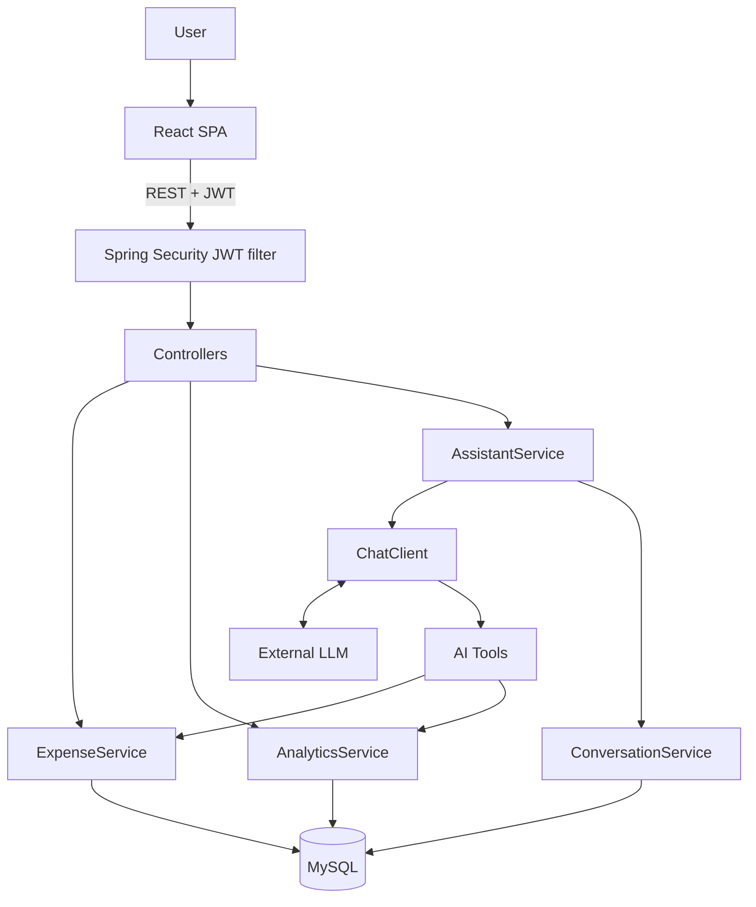

# PROJECT_OVERVIEW – AI Expense Assistant

> Primary reference. Read this first. Other documents: `ARCHITECTURE.md`, `API_DESIGN.md`, `BACKEND_DESIGN.md`, `FRONTEND_DESIGN.md`, `DATABASE_DESIGN.md`, `FLOW_DESIGN.md`, `IMPLEMENTATION_DESIGN.md`.

## 1. Introduction
AI Expense Assistant is a small multi-user web application for managing personal expenses. A user can work in two ways:

1. **Manual UI** – forms, tables and charts (React).
2. **AI Assistant** – a chat interface where the user types things like "I spent ₹500 on dinner yesterday".

Both interfaces call the **same backend services**. The AI is another *way to reach* the backend, not a second backend.

It is also a **learning project** (Spring Boot, Spring Security + JWT, Spring AI, Tool Calling, Structured Output, Chat Memory, REST, MySQL, React).

## 2. Problem statement
Tracking expenses in forms is slow, so people stop doing it. Typing a sentence is faster, but a chat bot that "remembers" numbers is unreliable for money. We need fast natural-language entry **and** trustworthy numbers. Solution: the LLM only understands language and chooses operations; the backend does all real work and calculations.

## 3. Objectives
- Full expense CRUD, date filtering, fixed categories.
- Analytics computed from real database rows.
- A conversational assistant that creates, finds, edits, deletes and analyses expenses, asks when information is missing, and never claims success without backend confirmation.
- Per-user data isolation.
- A staged build that teaches each technology step by step.

## 4. How the application works
1. User registers/logs in and receives a JWT.
2. **Manual path:** React → REST controller → service → repository → MySQL.
3. **AI path:** React → `POST /api/v1/assistant/chat` → `AssistantService` → Spring AI `ChatClient` ↔ LLM. When the LLM wants data or an action it requests a **tool**; Spring AI runs the tool method; the tool calls the *same* `ExpenseService` / `AnalyticsService`; the real result goes back to the LLM, which writes the reply.
4. Messages are stored in MySQL; recent context is supplied to the LLM through Spring AI Chat Memory.

## 5. Target users
Individuals who want to log and understand their personal spending, from a browser, with minimal effort. (Single currency: INR ₹.)

## 6. Core features
Registration/login/logout · expense CRUD · date-range, category and text filtering · analytics (total, by category, highest category, monthly summary, date-range report) · AI chat with follow-ups and clarification · confirmation for AI edit/delete · conversation history.

## 7. Functional requirements
Source: FRD v1.0 (unchanged IDs).

| ID | Requirement | Covered by |
|---|---|---|
| FR-01 | Register with name, email, password | `POST /auth/register` |
| FR-02 | Login with email, password | `POST /auth/login` |
| FR-03 | Logout | `POST /auth/logout` |
| FR-04 | Protected APIs require authentication | JWT filter, all endpoints except register/login |
| FR-05 | Users see only own expenses/conversations | `user_id` scoping in every query |
| FR-06 | Add expense (UI + AI) | `POST /expenses`, tool `addExpense` |
| FR-07 | View expenses (UI + AI) | `GET /expenses`, tool `searchExpenses` |
| FR-08 | Edit expense (UI + AI) | `PUT /expenses/{id}`, tool `proposeExpenseUpdate` + confirm |
| FR-09 | Delete expense (UI + AI) | `DELETE /expenses/{id}`, tool `proposeExpenseDeletion` + confirm |
| FR-10 | Filter by date range (UI + AI) | `from`/`to` on `GET /expenses`, `searchExpenses` |
| FR-11 | Categorize | `category` enum field |
| FR-12 | Total spending for a period | `GET /analytics/total`, `getTotalSpending` |
| FR-13 | Category-wise spending | `GET /analytics/by-category`, `getCategorySpending` |
| FR-14 | Highest spending category | `GET /analytics/highest-category`, `getHighestSpendingCategory` |
| FR-15 | Monthly summary | `GET /analytics/monthly`, `getMonthlySummary` |
| FR-16 | Date-range report | `GET /analytics/report`, `getDateRangeReport` |
| FR-17 | Chat interface | Assistant screen |
| FR-18 | Understands natural-language commands | `ChatClient` + system prompt + tools |
| FR-19 | Extracts structured expense data | Structured Output (`ExpenseDraft`) + typed tool parameters |
| FR-20 | Maintains context | Chat Memory |
| FR-21 | Follow-up questions | Chat Memory |
| FR-22 | Tool calling | `ExpenseTools`, `AnalyticsTools` |
| FR-23 | Responses from real backend results | tool results → LLM; BR-08 |
| FR-24 | Clarification for missing info | system prompt + tool validation errors |
| FR-25 | Previous conversations | `GET /conversations`, `GET /conversations/{id}` |

"Compare my October and November expenses" (FRD example) is served by calling `getMonthlySummary` twice (or `getDateRangeReport`); no extra endpoint.

## 8. Non-functional requirements
| Area | Requirement |
|---|---|
| Security | BCrypt hashing; JWT; user id only from authenticated context; no secrets in the repo (API keys via environment variables) |
| Data integrity | `DECIMAL(12,2)` money; DB constraints mirror business rules |
| Correctness | AI never computes totals itself (BR-10) |
| Performance | Typical list/analytics responses well under 1 s (indexed queries); AI replies bounded by LLM latency (timeout 30 s) |
| Reliability | LLM failure never corrupts data; clear `AI_UNAVAILABLE` error; manual UI works without the LLM |
| Maintainability | Modular monolith, layered, one rule set per concept |
| Usability | Responsive UI; loading/empty/error states |
| Testability | Services testable without Spring AI; tools testable with mocked services |

## 9. Technology stack
| Component | Choice | Why |
|---|---|---|
| Language | Java 21 | LTS; records and modern syntax suit DTOs/tool parameters |
| Backend | Spring Boot 3.5.x (see assumption A1) | Standard, mature, supported by Spring AI 1.1.x |
| Build | Maven | As agreed |
| AI | Spring AI 1.1.x | `ChatClient`, tool calling, structured output, chat memory in one API; provider-agnostic |
| Security | Spring Security + JWT (jjwt 0.12.x) + BCrypt | Stateless auth for a SPA |
| DB | MySQL 8.4 | As agreed |
| ORM | Spring Data JPA / Hibernate | Repositories without boilerplate |
| Migrations | Flyway | Versioned schema; needed to teach real-world DB change (small, not new infrastructure) |
| Frontend | React + TypeScript + Vite | As agreed |
| Frontend libs | React Router, TanStack Query, React Hook Form + Zod, Recharts | Routing, server-state, forms/validation, charts |
| API | REST/JSON, tested with Postman | As agreed |

## 10. Scope
Five modules: **Authentication, Expenses, Analytics, AI Chat, Conversations** (+ a small Common module). Two interfaces: Manual UI and AI Assistant.

## 11. Out of scope
Budgets · income tracking · bank integration · payment gateways · receipt scanning/OCR · recurring expenses · notifications · multi-currency · microservices/distributed infrastructure · admin/roles · email verification · password reset · social login · Redis/Kafka/RabbitMQ/vector DB.

*Possible future ideas (not designed here):* custom categories, CSV export, conversation delete/rename.

## 12. Architecture overview
Single Spring Boot application (modular monolith) + React SPA + MySQL + external LLM provider.

## 13. Modules
| Module | Package | Responsibility |
|---|---|---|
| User & Security | `user`, `security` | Accounts, login, JWT, current user |
| Expense | `expense` | Expense CRUD, validation, ownership |
| Analytics | `analytics` | Read-only calculations |
| AI Assistant | `assistant` | ChatClient, prompts, tools, pending actions |
| Conversation | `conversation` | Conversations and messages |
| Common | `common` | Errors, shared types, config helpers |

## 14. Key business rules
FRD rules BR-01 … BR-10 apply unchanged. Added precise rules:

| ID | Rule |
|---|---|
| BR-11 | Another user's expense/conversation is reported as **not found** (404), never "forbidden", to avoid leaking existence. |
| BR-12 | Amount: > 0, max 2 decimals, ≤ 9,999,999.99. |
| BR-13 | Description: optional text, max 255 chars. (Assumption A5) |
| BR-14 | Expense date: valid ISO date, not more than 1 day in the future (timezone slack). (A6) |
| BR-15 | AI edit and delete never execute directly: the AI creates a *pending action*; only the user's explicit confirmation (button → API) executes it. |
| BR-16 | A date range requires `from` ≤ `to`. |

## 15. Important architectural decisions
| # | Decision | Reason |
|---|---|---|
| D1 | Modular monolith | Small app, one deployable |
| D2 | Services own rules; controllers and tools are thin | One rule set for UI and AI (BR-09) |
| D3 | Services take `userId` as a parameter | Explicit ownership; AI tools get it from trusted context |
| D4 | Delete/edit confirmation enforced by backend, not by prompt | Prompts are not security |
| D5 | Two stores for chat: `chat_message` (history) and Spring AI memory (LLM context) | Different purposes, see ARCHITECTURE §11 |
| D6 | Stateless JWT + `token_version` for logout | Real logout without session storage |
| D7 | Auth built last, behind a `CurrentUserProvider` abstraction | Matches the learning order without insecure shortcuts |

## 16. Design corrections and assumptions

### Corrections to the notes
| # | Notes said | Correction |
|---|---|---|
| C1 | "Flow B" sequence diagram was a copy of Flow A | Replaced with the real AI flow (FLOW_DESIGN §AI). |
| C2 | Tool `getMonthlySpending` | Renamed to a consistent set (see below); `getMonthlySummary` plus `getTotalSpending`. |
| C3 | Confirmation only as a prompt rule | Backend-enforced pending-action mechanism (D4). |
| C4 | "Logout" with plain JWT | JWT is stateless; added `token_version` so logout really invalidates tokens. |
| C5 | Table named `User` | Use `users` (`user` is a reserved word in some SQL dialects). |
| C6 | "Chat Memory" and "stored messages" blurred | Separated clearly (D5). |
| C7 | Chat service "retains user context" | Passed per request via Spring AI `ToolContext`, never by the model. |
| C8 | `ChatMessage.role` as free String | Enum `USER`/`ASSISTANT`. |
| C9 | "Yesterday/this month" left to the LLM | Backend injects today's date and timezone into the system prompt; services receive concrete dates. |
| C10 | Controller path `/expenses` | Versioned base `/api/v1`. |

### Assumptions (for your review)
| ID | Assumption |
|---|---|
| A1 | Spring Boot 3.5.x + Spring AI 1.1.x. **Verify current versions at Stage 0** (Spring AI APIs changed between milestones). |
| A2 | LLM provider is a configuration choice; it must support tool calling. Key via env var. |
| A3 | Single currency INR; amounts are plain decimals, no currency column. |
| A4 | Default timezone `Asia/Kolkata` (configurable); dates are `LocalDate`, timestamps UTC. |
| A5 | Description optional, max 255. |
| A6 | Future-date limit of +1 day. |
| A7 | Access token only (60 min), no refresh token. |
| A8 | Pending AI actions held in memory with 10-minute expiry (lost on restart; acceptable for a learning app). |
| A9 | Pagination on expense and conversation lists (default 20, max 100). |
| A10 | Flyway for migrations; before Stage 10 a dev-only identity provider (see BACKEND_DESIGN §14). |
| A11 | Spring AI JDBC chat-memory table is created by Flyway and holds the last 20 messages used as LLM context. |

### Unresolved decisions (need you at the start of the stage)
- LLM provider and model (Stage 5).
- Whether the chat reply should stream (SSE). Designed as non-streaming; streaming is a future option.
